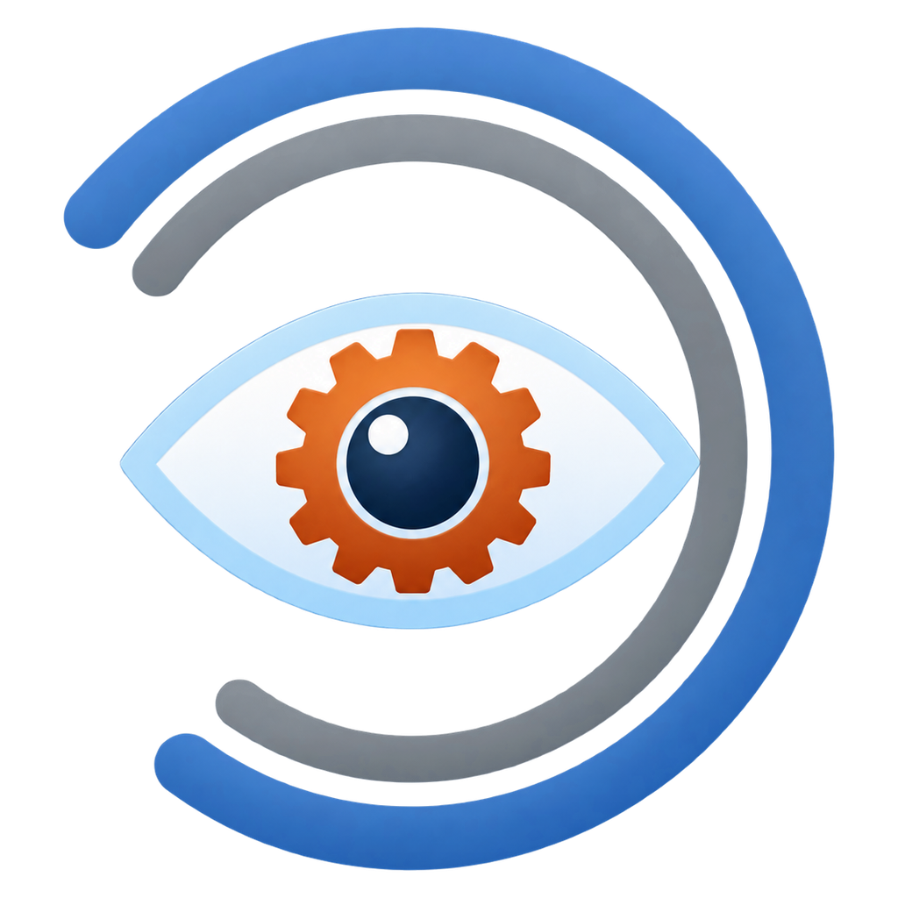
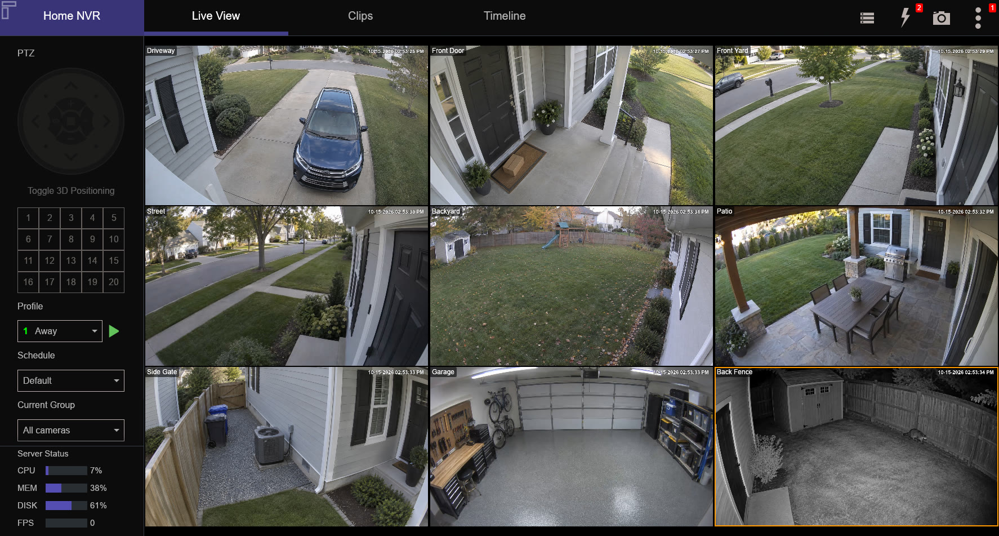
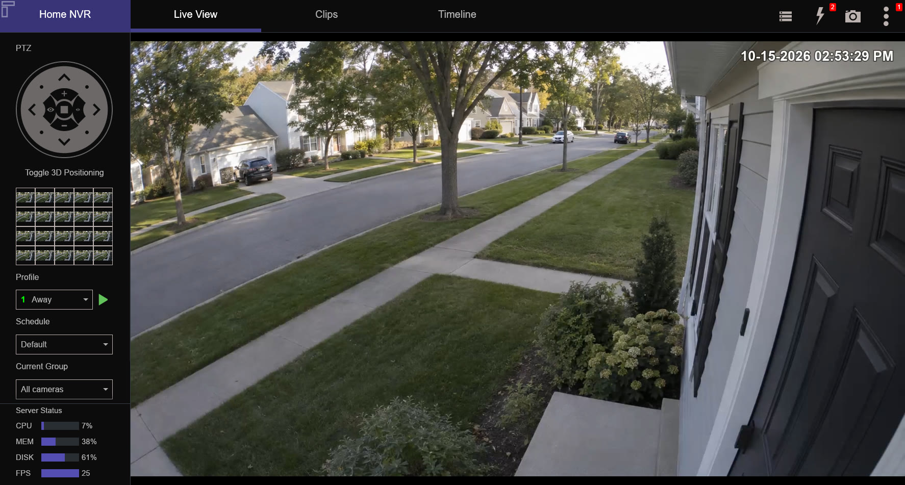
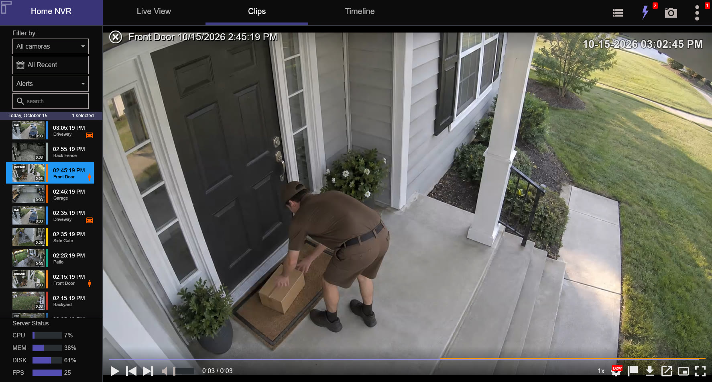
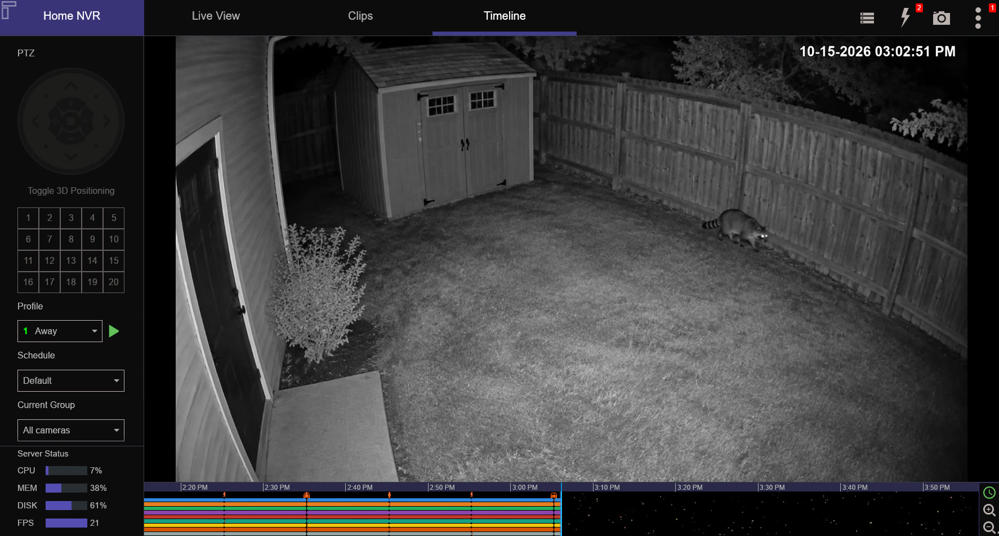
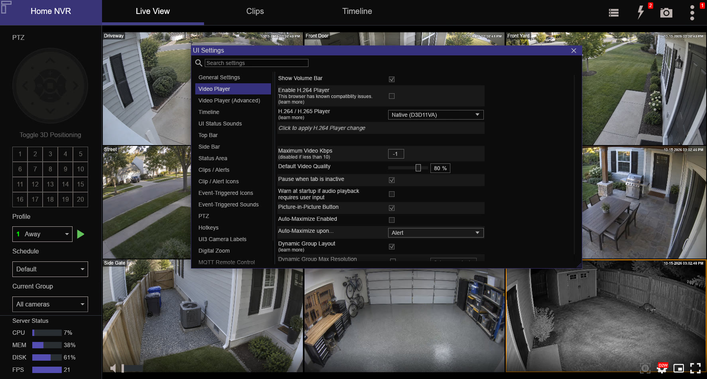

<p align="center">
  
</p>

<h1 align="center">UI3 Native</h1>

<p align="center">
  <strong>A fast, native Windows client for Blue Iris, built in Rust as a faithful port of <a href="https://github.com/bp2008/ui3">UI3</a>.</strong><br>
  Direct H.264 / H.265 playback · GPU hardware decoding · zero-copy rendering
</p>

<p align="center">
  
  
  
  
  
</p>

<p align="center">
  
  <br>
</p>

---

## Why UI3 Native?

[UI3](https://github.com/bp2008/ui3) is the excellent HTML5 interface that ships with Blue Iris. UI3 Native brings
the same layout, controls and settings to a standalone Windows application, and removes the browser's limits
on video:

- **No transcoding.** UI3 Native asks Blue Iris for the camera's *own* stream (direct-to-wire), so the server
  doesn't spend CPU re-encoding video for you, and you see the original quality.
- **H.265 everywhere.** HEVC is decoded on your GPU through FFmpeg D3D11VA (NVIDIA NVDEC, Intel Quick Sync, AMD VCN).
  It doesn't depend on browser codec support or the WebCodecs quirks of a particular browser.
- **Zero-copy video.** Decoded frames stay on the GPU. The DirectX 12 renderer samples the decoder's NV12 textures
  directly, with an automatic fallback to system memory copies when shared textures aren't available.
- **It still feels like UI3.** You get UI3's icon set, its five color themes, and the same top bar, side bar, clip
  list, playback bar, timeline and dialogs, plus the full UI3 settings catalog and hotkeys.

## Features

<table>
  <tr>
    <td width="50%" valign="top">
      <h3>📺 Live view</h3>
      View camera groups and single cameras, with full PTZ control. An optional client-side grid opens each camera's
      own stream, so Blue Iris doesn't have to composite or transcode the group, and H.265 cameras stay H.265. You
      also get auto-maximize on trigger, digital zoom with proportional mouse-wheel steps,
      event-triggered overlay icons, camera labels, a "Stats for nerds" overlay, and mini mode.
    </td>
    <td width="50%" valign="top">
      
    </td>
  </tr>
  <tr>
    <td width="50%" valign="top">
      
    </td>
    <td width="50%" valign="top">
      <h3>🎞️ Clips &amp; alerts</h3>
      Browse clips and alerts with thumbnails, flags, memos and date headers. The list follows the camera shown in the
      video area. Scrub quickly, play in reverse, change speed and step frame by frame. You can flag, protect, delete
      or download clips, and take snapshots locally or on the server.
    </td>
  </tr>
  <tr>
    <td width="50%" valign="top">
      <h3>🕒 Timeline</h3>
      Scroll and zoom through the recordings of every camera, with alert markers, skip-dead-air, and live previews
      while you drag. Each camera streams at its own native size. You can mark a start and end frame to export any
      segment.
    </td>
    <td width="50%" valign="top">
      
    </td>
  </tr>
  <tr>
    <td width="50%" valign="top">
      
    </td>
    <td width="50%" valign="top">
      <h3>⚙️ Everything UI3 can do</h3>
      All of UI3's settings categories carry over: video player, clips/alerts, timeline, PTZ, hotkeys, event-triggered
      sounds, status area, MQTT remote control and more. Each setting keeps its original description.
    </td>
  </tr>
</table>

### Full feature list

| Area | What you get |
|---|---|
| **Video** | H.264 & H.265 (8- and 10-bit) hardware decode · direct-to-wire or server-transcoded streaming profiles · per-camera stream sizing · default video quality setting · FLAC / μ-law audio with volume control |
| **PTZ** | Directional pad, zoom & focus · presets · 3D positioning (click / drag to aim) · virtual joystick and gamepad input · press-and-hold PTZ hotkeys |
| **Export** | Server-side Convert/Export (AVI, MP4, WMV) with a queue window · **client-side MP4 export that keeps H.265**, remuxed locally with no re-encode |
| **Server control** | Profile, schedule and hold/temp switching · trigger cameras · server status meters (CPU, RAM, disks, FPS) · log, users and devices views |
| **Events** | Event-triggered sounds (motion, trigger, alert) · UI status sounds · Windows text-to-speech · toasts |
| **Integration** | MQTT remote control (`ui3/<instance>/…`) to switch cameras, maximize, set volume, play sounds, speak text and show toasts. Works over WebSocket or plain TCP |
| **Look & feel** | Blue Iris 6, Blue Iris 6 Black, Blue Iris 5, Blue Iris 5 Black and legacy UI3 themes, or *Auto* (matches the server version) · 120 UI3 icons rendered as SVG |
| **Desktop** | Saved servers with passwords in **Windows Credential Manager** · anonymous auto-login · idle timeout · remembers window size and position · fullscreen |

## Requirements

- **Windows 10 or 11 (64-bit)** with a **DirectX 12**-capable GPU
- A **Blue Iris** server (5.x or 6.x) with its web server enabled
- For direct H.265 streaming: **Blue Iris 5.9.9.99 (2025-11-13) or newer**. Older servers still work and fall back
  to transcoded H.264.

## Getting started

1. Download the latest release from the [**Releases**](../../releases) page and extract it anywhere. It's portable,
   so there's no installer.
2. Run **`ui3-native.exe`**.
3. Enter your Blue Iris address (for example `http://192.168.1.10:81`) and your credentials.

Settings are stored in `%APPDATA%\UI3Native\config\settings.json`, and the log is written next to them as
`ui3-native.log`. Passwords never touch disk in plain text: they're kept in Windows Credential Manager.

> [!TIP]
> Open **Streaming Quality** in the side bar and pick **Native (direct H.264/H.265)** to get the camera's original
> stream with zero server-side transcoding. This is the default for new installs.

## Building from source

UI3 Native is a Cargo workspace (Rust **edition 2024**, so you need Rust **1.85+**). Native dependencies live inside
the project in `third_party/` (gitignored), so nothing is installed system-wide:

| Dependency | Where it goes | Source |
|---|---|---|
| FFmpeg 8.1 (LGPL, shared) | `third_party/ffmpeg/` | [BtbN FFmpeg-Builds](https://github.com/BtbN/FFmpeg-Builds/releases): `ffmpeg-n8.1-latest-win64-lgpl-shared-8.1.zip` |
| libclang (for bindgen) | `third_party/libclang/libclang.dll` | the [`libclang`](https://pypi.org/project/libclang/) Python wheel |

`.cargo/config.toml` points `FFMPEG_DIR` and `LIBCLANG_PATH` at those folders, and the `bi-media` build script copies
the FFmpeg DLLs next to every built binary.

```powershell
cargo build --release -p ui3-native      # build the app
cargo test --workspace                   # run the test suite
.\tools\package.ps1                      # portable release in .\dist\UI3Native (exe, FFmpeg DLLs, licenses)
```

### Developing without a server

`bi-mock` is an offline imitation of the Blue Iris web server. It implements the parts of the protocol the app
uses (login, camera list, status, clip/alert lists, timeline, PTZ, live and recorded streams, thumbnails) with the
real wire formats.

```powershell
cargo run -p bi-mock               # listens on http://127.0.0.1:8181  (user: admin / pass: admin)
cargo run --release -p ui3-native  # log in to http://127.0.0.1:8181
```

**Showcase mode** turns a folder of still images into a realistic camera system. That's how the screenshots in this
README were made:

```powershell
cargo run --release -p bi-mock -- 8181 --showcase path\to\images
```

Each `NN-name.png` becomes a camera (`03-front-yard.png` becomes **Front Yard**), laid out as a square grid group. Each
image is encoded once into a short H.265 or H.264 stream with a Blue Iris-style timestamp, and the results are cached
in `temp/showcase-media`. An optional `NNb-*.png` image supplies the footage for camera `NN`'s alerts, such as a
delivery at the front door.

### Inspecting a real server

`bi-capture` logs in from the command line and records or inspects raw streams. It's useful for checking which
codec Blue Iris actually sends. Put your server details in `temp/bi-server.json` (gitignored):

```json
{ "url": "http://host:81", "user": "...", "pass": "..." }
```

```powershell
cargo run -p bi-capture -- info
cargo run -p bi-capture -- live <camera-id> 10 native   # direct-to-wire, H.264 + H.265 accepted
```

## Project layout

| Path | Contents |
|---|---|
| [`app/`](app) | The `ui3-native` application (egui / wgpu UI, player, views, settings, MQTT, events) |
| [`crates/bi-proto/`](crates/bi-proto) | Blue Iris protocol: login, `/json` commands, URL builders, `/video/` stream container parser & writer |
| [`crates/bi-media/`](crates/bi-media) | FFmpeg video decode (D3D11VA + software), MP4 remux, JPEG decode, FLAC, audio output (cpal) |
| [`crates/bi-render/`](crates/bi-render) | wgpu NV12 → RGB conversion into egui textures |
| [`tools/bi-mock/`](tools/bi-mock) | Offline mock Blue Iris server for development and testing |
| [`tools/bi-capture/`](tools/bi-capture) | CLI to log in and record / inspect raw streams |
| [`tools/gen/`](tools/gen) | Generators: the settings table from UI3's `ui3.js`, the icon set from UI3's `icons.svg`, and the app icon sizes from `app/assets/logo.png` |
| [`tools/package.ps1`](tools/package.ps1) | Builds the portable release folder |

## How it works

```
Blue Iris ──/video/ stream──▶ bi-proto ──H.264/H.265 NALs──▶ bi-media (FFmpeg D3D11VA)
                              (parser)                              │ shared NV12 D3D11 textures
                                                                    ▼
                         egui UI ◀── wgpu DX12 ◀── bi-render (NV12 → RGB, zero-copy)
```

The client advertises `vcs=3` to Blue Iris, which tells the server it accepts both H.264 and H.265. Blue Iris can
then pass the camera's encoded video straight through instead of transcoding it.

## Credits

UI3 Native would not exist without **[UI3](https://github.com/bp2008/ui3) by [bp2008](https://github.com/bp2008)**,
the open-source HTML5 interface that has shipped with Blue Iris since 2018. This project is a port of UI3: its
layout, behavior, settings catalog (with descriptions), hotkeys, color themes and icon set all come from UI3, and the
source code references the corresponding `ui3.js` functions throughout. If you use Blue Iris in a browser, use
UI3. If you find this app useful, please ⭐ the [UI3 repository](https://github.com/bp2008/ui3) too.

Also built on:

- [FFmpeg](https://ffmpeg.org/), used for hardware video decoding and MP4 muxing (LGPL, unmodified shared libraries
  from [BtbN/FFmpeg-Builds](https://github.com/BtbN/FFmpeg-Builds))
- [egui / eframe](https://github.com/emilk/egui) and [wgpu](https://wgpu.rs/) for the UI and GPU rendering
- [tokio](https://tokio.rs/), [reqwest](https://github.com/seanmonstar/reqwest), [cpal](https://github.com/RustAudio/cpal),
  [rumqttc](https://github.com/bytebeamio/rumqtt), [gilrs](https://gitlab.com/gilrs-project/gilrs) and the wider
  Rust ecosystem

## License

UI3 Native is a derivative work of UI3 and is distributed under the
**[GNU Lesser General Public License v3.0](COPYING.LESSER)**, the same license as UI3. The LGPL is a set of
additional permissions on top of the [GNU General Public License v3.0](COPYING), so both texts are included.

FFmpeg is licensed under the LGPL v2.1 or later and is used as unmodified, dynamically linked DLLs. You can replace
them with any compatible build. Release packages include the GPL, LGPL and FFmpeg license texts in the `licenses/`
folder.

## Disclaimer

UI3 Native is an independent community project. It is **not affiliated with, endorsed by, or supported by Perspective
Software** or the UI3 project. *Blue Iris* is a trademark of Perspective Software. Please don't contact Blue Iris
support about this app; report issues [here](../../issues) instead.
